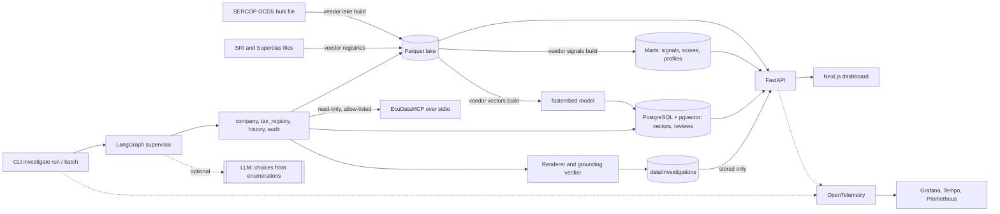

# Veedor

An open risk radar for public procurement in Ecuador. It computes transparent risk indicators over SERCOP's open contracting data, cross-checks winners against public registries, and writes an evidence dossier for each alert. A second stage adds an investigation step: a supervisor and four specialist agents gather extra evidence about a flagged process through read-only tools, including live lookups through EcuDataMCP (the author's own open-source MCP server), and the result goes through the same grounding checks as every other dossier.

> *Indicadores de riesgo, con su evidencia.* (Risk indicators, with their evidence.)

**Status:** runs locally with Docker Compose, with ports bound to `127.0.0.1`. It is not deployed publicly. The data is not in this repository (see [Quickstart](#quickstart)).

In Ecuador a *veedor* is a citizen overseer: someone who watches a public process and reports what the records show. The tool is meant for that role.

**Contents:** [What it is](#what-it-is-and-what-it-is-not) · [Example](#a-real-example) · [Key numbers](#key-numbers) · [Evaluation](#does-it-work-an-honest-evaluation) · [Multi-agent investigation](#multi-agent-investigation) · [Vector search](#vector-search) · [Observability](#observability) · [Performance](#performance) · [Grounding](#how-it-stays-grounded) · [Architecture](#architecture) · [Security](#security-summary) · [Reviews](#independent-reviews) · [Quickstart](#quickstart) · [Testing](#testing) · [Limits](#known-limitations) · [Roadmap](#roadmap) · [What it demonstrates](#what-this-project-demonstrates)

## What it is, and what it is not

- **It is** a set of documented rules (10 risk indicators and 2 zero-weight context indicators) applied to every process, a score that adds the risk indicators up, and a dossier that shows, for each fired indicator, the value, the threshold and the source field. For the highest-risk processes, an investigation adds registry and history facts gathered by agents.
- **It reports indicators, never accusations.** A fired indicator means a field is atypical under a stated rule. It does not mean anything improper happened. Single bidders, for example, are common in some procurement methods for ordinary reasons.
- **It is not a detector.** The evaluation below finds no evidence that the score singles out the one external list available. The agents add context for a human reader; they do not change the score.
- **Out of scope:** emergency procurement (absent from the open data) and catalogue purchases (no bidder data) are outside the competition analysis. Bidder and tender-window indicators never fire for them.
- Natural persons are masked in the API and the UI. Every dossier is a draft for human review. **Verbatim quotes from the text of a process are disabled by default** (`VEEDOR_QUOTES_ENABLED=false`): an independent review found persons named in them, the earlier estimate ("about 2 in 110,000") is withdrawn, and the measured residual is in [docs/QUOTES.md](docs/QUOTES.md): of 150 passages drawn uniformly at random from the final mart that I read, none named a person (95 % upper bound 2.0 %; 0 of 300 over two random rounds, 1.0 %), a sample read by one reader, not a guarantee.

## A real example

The dossier of a high-score process, built with `uv run veedor dossier build <ocid> --print --no-llm`. It is a 2018 works contract awarded by a small public entity to a company. **Names, RUCs and the OCID are withheld in this document**; they are replaced by `[entidad]` and `[proveedor]`. The text is Spanish because the product output is Spanish. The output is shown as generated, shortened.

| Indicator fired | Observed | Threshold |
|---|---|---|
| `SINGLE_BIDDER` | 1 bidder | 1 |
| `SHORT_TENDER_WINDOW` | 3.52 days | 4.04 days (5th percentile, same method and year) |
| `BUYER_CONCENTRATION` | 0.31 (31.3 % of the entity's awards that year; the largest single process is 15.8 %) | 0.3 |
| `CONTRACT_VS_COMPANY_SIZE` | 4.58 times the supplier's reported revenue of the previous year (2017) | 3 times |

Risk score: 60 out of 100 (weights 20 + 10 + 15 + 15).

```text
# Dossier [ocid]
Modo: template | verificación: aprobada (113 elementos comprobados) | intentos LLM: 0

El proceso [código] (Menor Cuantía) de la entidad [entidad], año 2018, presenta 4 señales de
riesgo: Oferente único; Plazo de ofertas atípicamente corto; Concentración de adjudicaciones
en un proveedor; Contrato desproporcionado frente a los ingresos del año anterior de la
empresa. Puntaje de riesgo: 60 sobre 100. Este documento es un borrador para revisión humana.

## Contexto comparativo
Procesos del mismo procedimiento (Menor Cuantía) y año (2018): 8.415.
Proporción de procesos con un solo oferente: 51,9 %.
```

Note the last line: in this method and year, about half of the processes have a single bidder. The dossier shows that context next to the indicator so a reader can discount it. What an investigation adds to a dossier is shown [below](#what-an-investigation-adds).

## Key numbers

Counts come from `data/marts/build_summary.json`, `eval/coverage.json` and `docs/DATA_SOURCES.md`, built on 2026-11-16. The two generated files agree on every figure below.

| Item | Value | Source |
|---|---|---|
| Processes analysed | 2,251,027 | `build_summary.json` `marts_rows.process_scores`; `coverage.json` `n_processes` |
| Release dates | 2015-01-05 to 2026-11-09 (2026 is a partial year; a DuckDB query on the lake) | query on the lake |
| Catalogue / competitive / direct / without tender block / other | 1,865,093 / 267,037 / 95,445 / 19,862 / 3,590 | `coverage.json` `by_method_group` |
| Processes with at least one risk indicator | 87,217 (3.9 %) | `coverage.json` `n_with_any_signal` |
| Competitive processes with at least one risk indicator | 81,936 (30.7 %) | `coverage.json` `by_method_group` |
| Processes with at least one context indicator | 658 | `coverage.json` `context_signals` |
| Indexed for vector search | 365,864 | `eval/vector_search.json` `index.rows` |
| Stored investigations on the development machine | 26 | file count of `data/investigations/` |
| Marts build time | 4.7 s | `build_summary.json` `duration_seconds` |

Times each indicator fired:

| Indicator | Fired | Scope |
|---|---|---|
| `SINGLE_BIDDER` | 59,268 | competitive; method-category cells with no real competition are excluded |
| `RECURRING_COBIDDERS` | 11,417 | competitive |
| `CONTRACT_VS_COMPANY_SIZE` | 5,957 | winner has Superintendencia revenue for an earlier year |
| `LOW_SAVING` | 4,289 | competitive, method-years where it is evaluated |
| `REPEATED_DIRECT_AWARDS` | 3,361 | direct |
| `BUYER_CONCENTRATION` | 3,231 | non-catalogue; one process alone cannot reach 30 % |
| `SHORT_TENDER_WINDOW` | 3,092 | competitive with both dates |
| `NEW_SUPPLIER` | 1,307 | non-catalogue, company or public-entity winner in the SRI registry |
| `SUPPLIER_NOT_ACTIVE` | 16 | non-catalogue, company or public-entity winner, suspension before the process |
| `GHOST_COMPANY_LIST` | 0 | listing notified on or before the process date, company or public-entity winner |
| context: `CONTRACT_VS_COMPANY_SIZE_SAME_YEAR` | 614 | weight 0 |
| context: `GHOST_COMPANY_LISTED_LATER` | 44 | weight 0 |

Risk score distribution (weights are uncalibrated judgement calls; a score of 0 means "no indicator fired", not "low risk"):

| Score | Processes |
|---|---|
| 0 | 2,163,810 (96.125 %) |
| 10 to 25 | 83,229 |
| 30 to 45 | 3,961 |
| 50 or more | 27 |

Maximum 60; 99th percentile 20; 99.9th percentile 30.

Registry coverage (`docs/DATA_SOURCES.md`): the SRI registry matches 68,584 of 68,587 awarded RUCs; the Superintendencia de Compañías matches 15,401 of 19,847 awarded company RUCs; 16 awarded RUCs appear on the SRI "empresas fantasmas" list (1,113 RUCs in total). Registry-derived indicators are computed only for company and public-entity winners: attaching a registry qualification, tax status or start date to an identifiable individual would publish information about that person. The build summary records what this excluded (for example 1,291 `NEW_SUPPLIER` firings and 16 `SUPPLIER_NOT_ACTIVE` firings).

## Does it work? An honest evaluation

Short answer: **the available evidence does not show that the score singles out suppliers on the one external list we could use.** The full report is [docs/EVALUATION.md](docs/EVALUATION.md); this is the summary. It evaluates the indicator score only; the agents are not part of it.

**Setup.** The only official outside label is the SRI list of "empresas fantasmas" (shell companies). Of its 1,113 RUCs, 9 are companies that won public contracts as process winner. We asked whether a score that excludes the indicators derived from the label ranks these 9 above the other 19,837 contract-winning companies.

| Result (held-out score, supplier mean, companies only) | Value |
|---|---|
| ROC-AUC (0.5 is chance) | 0.447 (95 % interval 0.303 to 0.598) |
| Permutation p-value, one-sided | 0.706 |
| Matched on method and year: stratified concordance (0.5 is no difference) | 0.387 (0.326 to 0.491) |
| Matched: observed / expected mean score | 0.44 (0.11 to 0.93) |
| Naive baseline, total amount awarded | AUC 0.525 (0.326 to 0.730) |

The headline interval includes 0.5. The matched comparison lies entirely below 0.5: if anything, the processes of the listed companies carry fewer indicators than comparable processes. None of the held-out variants has an interval entirely above 0.5.

**Why it cannot say more.**

- **Tiny positive set.** 9 companies. The intervals are wide, so a modest real effect cannot be ruled out either. This is absence of evidence, not evidence of absence.
- **The label measures tax behaviour, not procurement.** Being on the list is a tax-administration classification of a company, not a finding about a contract.
- **Positives are not independent.** The 44 processes of the 9 companies span 23 buyers; 11 of those processes (25.0 %) are at a single buyer, and 5 of the 9 companies share a buyer with another positive. The effective number of buyers is 10.9.
- **Unlisted does not mean clean.** The setting is positive-unlabelled, which pushes every metric toward chance.

**Analysis history (`eval/history.json`).** The evaluation was run four times on the same labels, and the rules changed in between:

| Run | What changed | Headline AUC (95 % CI) |
|---|---|---|
| 1 | Initial rules | 0.474 (0.315 to 0.661) |
| 2 | `SUPPLIER_NOT_ACTIVE` made time-aware (27,291 to 32 firings) | 0.474 (0.315 to 0.661) |
| 3 | Rules refined after review: `SINGLE_BIDDER` 74,964 to 59,268; `GHOST_COMPANY_LIST` 165 to 6 (159 moved to a context indicator); `BUYER_CONCENTRATION` 13,496 to 3,231; `CONTRACT_VS_COMPANY_SIZE` 4,023 to 5,957 | 0.447 (0.303 to 0.598) |
| 4 | Registry-derived indicators restricted to company and public-entity winners, for data-protection reasons | 0.447 (0.303 to 0.598) |

The rules were changed for correctness reasons found by review, and the project record says no rule was changed to move the metric. The metric moved down, not up, and the conclusion did not change. Even so, adjusting rules after looking at a metric on the same labels is a source of optimism: the labels are no longer a clean, independent test of the final rules. Read the latest figure as a descriptive check, not as an unbiased estimate of performance. In earlier runs the full production score gave an inflated AUC because it contained the label itself; that was leakage, not skill, and it is gone after the timing split.

**Lessons from looking at things by hand.**

- **A defect that tests did not catch.** Reading one dossier showed a supplier flagged as not active that was still active when the process happened. The rule used the supplier's current SRI status. `SUPPLIER_NOT_ACTIVE` fired 27,291 times before the fix and 32 after, because 27,259 of those suspensions came after the process date (16 today, after the registry restriction). All automated tests were green before the fix.
- **Reviews broke guarantees the author believed were met**, with every test green (masking, and the trust placed in generated text). As a result the model stopped writing prose.
- **One rendered page** showed a registry qualification attached to an identifiable individual, so registry-derived indicators are now computed only for companies and public entities.
- **Naive readings mislead.** Across all processes `SINGLE_BIDDER` has a ratio of 2.29 (interval 0.00 to 5.94) between listed and other companies; among non-catalogue processes it is 0.24 (0.00 to 0.46). Part of any all-process gap is method mix.

**What this means.** The indicators are descriptive transparency measures that point to atypical features of a process for a human to look at. They are not validated predictors of wrongdoing, and no labelled set of proven problem contracts exists in the open data to test that. A high score is not an accusation.

### Question answering: two sets of numbers, and where it is weak

`POST /processes/{ocid}/ask` is off by default. Its retrieval-only mode (no model) was measured on 310 unseen processes
(`eval/qa.json`, `docs/EVALUATION.md`) with two question sets, because the first one overstated it (review 5): the
original phrasings share words with the retrieval key phrases (29 of 73 answerable templates were verbatim keys).

| Retrieval only, unseen processes | In-vocabulary phrasing (n = 1,439 answerable) | Unseen phrasing (independent wording, n = 1,439 answerable) |
|---|---|---|
| Recall of the expected facts | 83.7 % (81.8 to 85.5) | **14.2 %** (12.4 to 16.1) |
| Answerable questions answered with no fact | 3.2 % | 75.7 % |
| Abstention on unanswerable questions (n = 930) | 79.7 % (77.2 to 82.4) | 88.0 % (85.9 to 90.0), because it says nothing to most questions |

**Weak categories, stated next to any headline number:** `signals_all` (24 % in-vocabulary, 0 % unseen), `ghost` (42 %, 0 %),
`registry_company` (54 %, 0 %), `history` (50 %, 12 %), `pair_others` (n = 2: 0 %, 0 %) and, with unseen phrasing, also `winner`, `object`, `amounts`,
`procedure` and `registry_sri` (83 to 100 % in-vocabulary, 0 % unseen). The system was **not retuned** to the new set. Model mode (`gpt-5.4-mini`) was measured
on the in-vocabulary phrasings only, over n = 172 questions; it was not rerun on unseen phrasings.

## Multi-agent investigation

For a flagged process, `veedor investigate` runs a **supervisor plus up to five specialists** (LangGraph; the fifth, on the question-and-answer stage, runs only when the process has stored texts). Each specialist has one objective, an allow-list of read-only tools and a budget of 4 tool calls. Facts are gathered and computed by code; a model, when configured, only chooses among enumerated options. Full design and threat model: [docs/AGENTS.md](docs/AGENTS.md).

| Agent | Objective | Tools |
|---|---|---|
| Supervisor | Decide which specialists run and in what order, with a reason from a closed list. Budget: 6 dispatches per investigation, at most 2 per specialist. | none |
| `company` | Incorporation date and days to the process, subscribed capital and the award/capital multiple, legal status, latest financial statements before the process year. | `get_compania_info`, `get_financials` (EcuDataMCP) |
| `tax_registry` | Live SRI public record: status, taxpayer class, size category, activity start, and whether it agrees with the downloaded table. | `get_sri_ruc_info` (EcuDataMCP) |
| `history` | Other awards between this buyer and supplier; similar purchases by the same buyer within 180 days, from the vector index. | `pair_awards` (lake), `similar_processes` (vector index) |
| `audit` | Contraloría approved-report rows whose audited entity equals the buyer by exact normalised name. | `list_catalogo`, `get_contraloria_informe` (EcuDataMCP) |

**Safety design**

- **Enumerated actions, targets resolved by code.** A specialist picks from (tool, target) pairs where the target is `winner`, `buyer` or `process`. Code turns it into the real RUC, ocid or buyer name after strict pattern checks. A model never writes a tool argument.
- **Read-only, allow-listed tools.** `ToolRunner` is the only code path that calls a backend and refuses any tool outside the specialist's list.
- **Tool results are data, never instructions.** Every result is parsed into typed fields by a pydantic model that declares only the fields used (a legal representative's name is never declared, so it is dropped), vocabularies are closed, and the returned RUC must equal the requested one. No string from a tool is placed in a prompt, used as an argument, a path, a URL or SQL.
- **Budgets and timeouts.** Dispatch and per-specialist limits are enforced in code. Every call has a timeout, at most one retry and a recorded outcome (`ok`, `timeout`, `upstream_error`, `invalid_result`, `skipped`). A failed lookup becomes "no disponible (la fuente no respondió)" and never aborts the run.
- **Deterministic policy without a model.** A rule table maps fired indicators to specialists. With no model, every decision falls back to it; with a model, an invalid reply is retried once and then replaced by the policy.
- **Natural persons.** Registry lookups run only for companies and public entities. The store refuses to write a record that contains a natural person's RUC or cédula.
- **The HTTP API never starts an investigation.** Investigations come from the CLI and are stored; the API serves the stored record (`GET /api/v1/processes/{ocid}/investigation`, 404 when none).

**Measured results** (`eval/investigations_run.json`, live EcuDataMCP; the batch takes the highest-risk processes, so it is not a random sample):

| | Without a model (policy) | Model-assisted |
|---|---|---|
| Investigations / errors | 20 / 0 | 10 / 0 |
| Dossiers passing verification | 20 (all `template`) | 10 (all `llm` mode) |
| Withheld by the privacy guard | 0 | not recorded in the file |
| Specialists dispatched | all four, in all 20 | `company`, `history`, `audit` in all 10; `tax_registry` in 3 |
| Tool calls | 180, all `ok` | 83: 82 `ok`, 1 `upstream_error` |
| Model calls / invalid choices | 0 / 0 | 54 / 0 (`gpt-5.4-mini`; 45,003 prompt and 3,600 completion tokens) |

**The model-assisted run of 10 predates the last fixes (review 3 and review 4) and was not repeated.** The file does not record when the no-model block was run. The model path was reviewed only with a scripted fake model, not a real one.

### What an investigation adds

One stored investigation, shown with `uv run veedor investigate show <ocid>`. This one ran in `template` mode with no model calls, 4 specialists, 9 tool calls (all `ok`) and 13 facts added; verification passed. Company, entity, RUC, process code and dates are replaced by placeholders; the other values are as generated. Lines are quoted without interpretation.

```text
Capital suscrito: USD 400,00 (cifra registrada a la fecha de la consulta; no es necesariamente el
vigente al momento del proceso). La relación compara el monto adjudicado con el capital registrado
a la fecha de la consulta: el monto adjudicado equivale a 452,5 veces el capital suscrito.
Fecha de constitución: [fecha]. Entre la constitución y la fecha de referencia del proceso
(fecha de adjudicación: [fecha]) transcurrieron 675 días.
Consulta en línea al SRI (estado a la fecha de la consulta): estado activo; clase de contribuyente:
otro; categoría de empresa: micro. Inicio de actividades según la consulta: [fecha].
El estado de la consulta en línea coincide con el estado del listado descargado del SRI.

Entre las 50 compras más similares de la misma entidad según la descripción del objeto, 50 superan
una similitud mínima de 0,75, y 3 de ellas están a 180 días o menos de la fecha de referencia del
proceso; su monto combinado es USD 495.355,97 (monto informado en 3 de ellas).

Informes de la Contraloría General del Estado referidos a la entidad compradora: no se pudo
establecer. Se examinaron 600 filas de 3 de los 8 archivos de informes aprobados del catálogo; el
servicio entrega solo una parte de las filas de cada archivo. Que no aparezcan en las filas
examinadas no implica que no existan.
```

The last item is typical: the audit specialist reads part of the catalogue, so it can confirm "at least N reports" but cannot rule any out, and says so.

## Vector search

"Similar processes" finds what a process bought by looking at others that bought something alike. It is a search aid used by the `history` agent and the dashboard. It never feeds the risk score. Details: [docs/VECTOR_SEARCH.md](docs/VECTOR_SEARCH.md).

- **What is embedded, and why.** For every non-catalogue process, `"<CPC description>. <description>"` truncated to 1,000 characters. The CPC description gives the category; the description gives the object.
- **Privacy.** The description passes `safe_free_text` masking first. It is withheld, and only the CPC description is embedded, when the winner is a masked party or masking finds any personal item. The table `process_vectors` has no text column: it stores the vector, a SHA-256 of the text, the model name and non-sensitive metadata. 46.9 % of indexed rows are embedded from the classification alone because of this (171,498 of 365,864).
- **Model and index.** `minishlab/potion-multilingual-128M` through `fastembed` (multilingual, 256 dimensions, MIT licence, local, no API key). PostgreSQL with pgvector and an HNSW index (`vector_cosine_ops`, `m=16`, `ef_construction=64`).
- **Coverage.** 365,864 rows indexed; 206 in-scope processes had no safe text and were not indexed. Query latency of `find_similar` over 200 queries: p50 14.1 ms, p95 20.3 ms.

**Evaluation** (`eval/vector_search.json`; the proxy label is the CPC 5-digit prefix; mean and 95 % bootstrap interval, 1,000 query processes, top 10):

| Measure | Value |
|---|---|
| Full index: agreement, embedding neighbours | 81.3 % (79.2 to 83.4) |
| Full index: random neighbours | 1.7 % (1.4 to 2.1) |
| Pool of 20,000, classification text included in the embedding | 63.3 % (61.0 to 65.8) |
| Pool of 20,000, description only | 29.8 % (27.7 to 31.8) |
| Pool of 20,000, random neighbours | 2.4 % (2.0 to 2.8) |

**Honest reading.** The headline 81.3 % is optimistic. The embedded text contains the CPC description, which is the same thing the proxy label measures; almost half of the index is represented by the classification alone, so those neighbours are same-category by construction; and CPC agreement is a proxy, not relevance (similar purchases can carry different codes). Removing the classification text from the embedding drops agreement from 63.3 % to 29.8 % on a 20,000-process pool, against 2.4 % for random neighbours. Removing identical descriptions changes that by less than 0.5 points. The figure to trust is therefore the description-only one: well above random, far from the headline.

## Observability

OpenTelemetry traces and metrics for every API request and every investigation step, with a Grafana dashboard in the local stack. Off unless `VEEDOR_OTEL_ENDPOINT` is set; without it every helper is a no-op. Details: [docs/OBSERVABILITY.md](docs/OBSERVABILITY.md).

- **Traced:** one server span per HTTP request named by route template (`/health` excluded), and spans for the investigation, each specialist, each tool call and each graph node.
- **Measured:** HTTP rate, errors and latency by route; investigations by final mode; specialist runs; tool calls by tool and outcome; tool latency; model tokens; grounding pass rate.
- **Attribute allow-list (privacy).** Public procurement data contains people, and telemetry is easy to copy and keep. A span attribute or metric label whose key is not on an allow-list is dropped, and each allowed key has its own value rule: closed vocabularies for tool, specialist, outcome and mode (anything else becomes `other`), exact shapes for `ocid` and route templates, ranges for counts and durations. Exceptions are recorded by class name only, never with their message. The stock FastAPI instrumentor was not used because it records raw paths. Tests with in-memory exporters check that RUC-shaped and free-text values never reach the exporter.
- **Dashboard.** Grafana "Veedor" is provisioned with 10 panels (request rate, errors and latency by route; investigations by mode; specialist runs; tool outcomes and latency; tokens; grounding pass rate; recent traces). It runs in one development image, `grafana/otel-lgtm` (Collector, Tempo, Prometheus, Loki, Grafana). A screenshot is in `ops/observability/screenshots/`.
- **How it was verified.** `make obs-verify` generates traffic (API requests and investigations) and `scripts/verify_telemetry.py` queries Tempo and Prometheus, failing unless the expected spans and series exist, `/health` is absent, and no span or label holds a 13-digit number or a stray `ocds-` id. Review 3 also searched stored records, traces, spans and metric labels for names, streets and phones returned by the registry for 14 companies: 0 hits. I did not rerun `make obs-verify` for this README.

Limits: local single node, 100 % sampling, no alerting, no authentication on the loopback collector ports.

## Performance

The API reuses one locked-down DuckDB database per worker (a cursor per call) instead of opening one per request. Measured on the local compose stack (Colima VM, 4 CPU, 6 GB, lake bind-mounted from macOS) with `scripts/load_test.py`, same mixed route set, one run each (`docs/DEPLOYMENT.md`):

| Load | Before (new connection per request, 1 worker) | After (reused database, 2 workers x 2 threads) |
|---|---|---|
| 200 req @ 8 | p50 1.00 s, p95 2.25 s, 7.7 req/s | p50 0.22 s, p95 0.87 s, 25.1 req/s |
| 600 req @ 8 | p50 1.04 s, p95 2.26 s, 7.5 req/s | p50 0.24 s, p95 1.31 s, 22.5 req/s |
| 300 req @ 32 | p50 3.83 s, p95 14.35 s, 6.2 req/s, 44 transport errors | p50 0.86 s, p95 7.40 s, 20.8 req/s, no errors |

**Still slow, and why.**

- Search by text (`GET /processes?q=...`) scans two text columns of the 2.25 M-row table on every call (about 0.2 s on the host, 1.4 to 8 s in the container under load). It needs a precomputed search column or index.
- Bind-mounted Parquet on macOS is slower than on the host (about 46 req/s on the host against 22 in the container for the same mix). That is Docker's file sharing, not the code.
- At concurrency 32 on 4 CPUs the queue, not the query, dominates the tail.

## How it stays grounded

1. **Deterministic facts first.** Facts, indicators, registry matches and investigation findings are computed by code into an evidence pack. With no LLM configured, a template renders the dossier.
2. **The model does not write prose.** In LLM mode it receives a catalogue of fact ids and returns a plan: the order of fact ids per section, which context facts to include, one connective per section from a closed set and one reviewer note from a closed set. The renderer writes every sentence from the same templates as template mode. A plan with an unknown id, free text or more than one connective is rejected; after two failed attempts the template is used. The model cannot add or change a figure, name an entity, drop a risk signal, hide a failed lookup, touch the limitations section or add a source. It can hide context facts and choose emphasis, so it can change what a reviewer reads first. That is all of its influence.
3. **Grounding verifier, still applied.** Every number, date, RUC, code, spelled-out number and capitalised name in the rendered text must exist in the evidence pack, forbidden wording is rejected, and free text may appear only as a verbatim `« »` quote of the data. Unverified text is never stored or shown. The guarantee is structural rather than lexical: code writes every sentence, and the free-text process description is not loaded or quoted in the dossier.
4. **The HTTP API never calls an LLM and never starts a lookup.** Dossiers served over HTTP are always template mode. LLM dossiers and investigations are produced only by the CLI, and no LLM variable is passed to the containers.
5. **Prompt-injection threat model.** Tender descriptions, names, registry text and tool results are written by third parties and can contain planted instructions. Untrusted strings travel only inside a delimited data block with control characters removed and lengths capped, tool results are parsed into typed fields (see the safety design above), and the structural defence is that the model's output is a plan over ids, not text.

**Known limits of the verifier.** It checks that values exist in the evidence, with field binding only for values that follow a known label. A bare figure that follows no label is checked by membership only, only capitalised names are detected, and meaning is not checked: a true figure used in a misleading sentence would pass. In review 2, 35 of 82 fresh evasions passed the forbidden-word list, which is why the guarantee is structural.

**Real-model results for the dossier plan** (`eval/llm_grounding_runs.json`, model `gpt-5.4-mini`, "top 20 by risk score" in each run, one run each, small samples):

| Run | Passed first attempt | Passed after retry | Fell back to template | LLM calls | Prompt / completion tokens | Median latency |
|---|---|---|---|---|---|---|
| 1. Free prose under the strict verifier (field binding, prompt v1) | 2 | 5 | 13 | 38 | 67,340 / 22,643 | 6,184 ms |
| 2. Constrained generation (model selects fact ids, renderer writes all text) | 5 | 9 | 6 | 35 | 73,924 / 6,107 | 2,673 ms |

In both runs all 20 final dossiers passed grounding, because failures fall back to the template. The file does not state that the two runs used the same 20 processes. Even with constrained generation, 6 of 20 plans were rejected twice and fell back to the template.

## Architecture

Parquet files hold the read-only analytics data and DuckDB queries them in memory. PostgreSQL (with the pgvector extension) holds human reviews, which are disabled by default, and the vector index. Investigations are stored as JSON files written by the CLI and read by the API. The API serves masked responses and the Next.js dashboard renders them.



**Layer rule.** `domain` (indicators, scoring, dossier and investigation templates and policies, grounding verifier, masking) imports nothing from the other layers. `use_cases` depend on `domain` and on ports; `infrastructure` implements the ports; `api` and `cli` only call use cases. One known deviation is documented in `docs/ARCHITECTURE.md`.

| Piece | What it does |
|---|---|
| Python 3.12, uv, ruff, pytest | language, packaging, lint, tests |
| DuckDB + Parquet | read-only analytics; indicators are set-based SQL |
| scikit-learn | Isolation Forest anomaly score, reported separately and never part of the risk score |
| FastAPI + Pydantic | API and response models, where masking is applied |
| LangGraph | dossier graph (load evidence, assess, plan, render, verify, finalize or fall back) and the investigation graph (supervisor and four specialist subgraphs) |
| MCP Python client + EcuDataMCP | live registry and Contraloría lookups over stdio, read-only |
| PostgreSQL (pgvector image) + SQLAlchemy + Alembic | human reviews and the vector index (HNSW) |
| fastembed (`potion-multilingual-128M`) | local multilingual embeddings, 256 dimensions |
| OpenTelemetry + Grafana (`otel-lgtm`: Tempo, Prometheus, Loki) | traces, metrics, provisioned dashboard |
| Typer | the `veedor` command line |
| Next.js 16, React 19, Tailwind 4 | dashboard, including stored investigations, similar processes and an agents page |
| Docker Compose | local stack: web, api, db, observability, one-off migration |

## Security summary

Full threat model and findings: [docs/SECURITY.md](docs/SECURITY.md) and, for the agents, [docs/AGENTS.md](docs/AGENTS.md).

- **SQL injection.** All values are bound parameters. The only variable SQL text is the sort column, taken from a closed mapping. Path and query parameters are validated and bounded.
- **DuckDB lockdown.** The API reuses one in-memory database per worker, locked down once: views over known Parquet files only, `allowed_directories` restricted, external access disabled, configuration locked, one `SELECT`/`WITH` statement per call (because the database outlives a request). Review 4 ran 65 attacks through this reader and found them refused or harmless.
- **Masking of natural persons.** A RUC whose third digit is 0 to 5 is a natural person: the name becomes "Persona natural" and the RUC keeps four digits. A party with no usable RUC is masked unless its name carries a legal-entity marker (default is to mask). Free-text descriptions are withheld when they contain personal identifiers, including 10-digit cédulas. Supplier pages of natural persons return the same 404 as an unknown RUC. Masking is applied in the response models.
- **Agents and tools.** Read-only, allow-listed tools; arguments built by code; results parsed into typed fields; no registry lookup for natural persons; legal-representative names never declared, stored, logged or sent to a model; stored records are scanned for natural-person identifiers (values and keys, normalised) and withheld when one is found; every call has a timeout and a recorded outcome.
- **Quotes are off by default.** Stored quotes (verbatim text written by bidders and entities) are served only with `VEEDOR_QUOTES_ENABLED=true`. The screens were rebuilt as deny by default (a passage is shown only if nothing in it could be a person) after review 5 found persons in the earlier mart; a release gate (`scripts/check_quotes_privacy.py`) fails the bundle build when any stored passage matches the reviewer's rules or the project's own, and the bundle ships no quotes without `--with-quotes`. The residual was measured by reading samples, with a stated bound, not proven: of 150 passages drawn uniformly at random from the final mart that I read, none named a person (95 % upper bound 2.0 %; 0 of 300 over two random rounds, 1.0 %), a sample read by one reader, not a guarantee. Never described as free of personal data.
- **Telemetry carries no personal data by construction** (attribute allow-list, see above).
- **Limits, stated plainly.** Name masking in free text is heuristic: a name that is neither a known party of the process nor preceded by an honorific can still appear in a description shown by the process detail page. Dossiers do not quote descriptions. **The data directory and the Parquet files contain unmasked personal data (names, RUCs, cédulas) and must never be published or shared as-is.** Masking exists only at the API boundary. Investigation facts about legal status and capital are snapshots of today's registries, labelled as such.
- **Reviews are disabled by default.** Writing a review requires `VEEDOR_REVIEWS_ENABLED=true` and a bearer token. The token is one shared secret, not a per-user identity. There is still no user authentication, so do not expose the API to the internet. The review and dossier rate limiters are per worker and in memory (reset on restart). The `/ask` budget and per-client counters are shared in PostgreSQL in compose (`VEEDOR_ASK_USAGE_SHARED`), per worker otherwise; see [docs/SECURITY.md](docs/SECURITY.md).
- **Ports** (web 3000, api 8000, PostgreSQL 5433, Grafana 3001, OTLP 4318, Prometheus 9090, Tempo 3200) are bound to `127.0.0.1`. The Grafana password in compose is a local-development default.

## Independent reviews

Five independent, adversarial, read-only reviews were run on 2026-11-16, each by a reviewer who started without knowledge of the codebase and was asked to break the project's claims. Full record, including what remains open: [docs/REVIEWS.md](docs/REVIEWS.md).

| Review | When | Result |
|---|---|---|
| 1 | After the first build, every test green | Broke masking (personal data in free text, parties without a RUC) and the text verifier, and found HTTP 500s and open review writes. Held: 40 SQL-injection payloads and 19 file-access attempts had no effect. The model stopped writing prose as a result. |
| 2 | After those fixes | Confirmed the high-severity fixes; a privacy sweep of 1,640 processes (3,280 responses) found 0 leaked names, 0 unmasked natural-person RUCs, 0 valid cédulas. Found over-masking, transient 500s, a weaker review wording filter, and that 35 of 82 fresh evasions passed the word list. |
| 3 | Stage 2: agents, vectors, telemetry | Re-derived the facts of six processes from primary sources (all matched); a hostile fake tool server leaked nothing; budgets held. Broke it: a privacy-scan crash (7 of 80 offline runs, 1 of 15 live) and the API returning 404 for every stored investigation in compose; plus fiscal-year, out-of-range-value and snapshot-labelling defects. |
| 4 | Re-test of the stage 2 fixes | The crash was gone (13 of 13 live and 320 offline investigations completed); 65 attacks on the shared database reader refused; 200 requests at concurrency 8 gave p95 0.64 s. Found the privacy scan narrowed too far (no cédula, no formatted RUC), an unchecked report-number field, and a Contraloría list that silently omitted 3 of 9 reports. |
| 5 | Before publication | Concluded the project was **not fit to publish**. Found natural persons named in the stored quotes (62 passages by 7 simple regular expressions, about 120 by reading, 54 quoting vehicle plates) although the project had claimed about 2 in 110,000; 785 passages of accusation-like third-party text beside risk signals; question-answering evaluation partly measuring the retrieval keys (29 of 73 templates were verbatim keys); 891 identifiers returning 422; per-worker rate limits. Fixes and measurements: [docs/REVIEWS.md](docs/REVIEWS.md). Quotes are now off by default. |

Reviews 3 and 4 tested the agent graph with a scripted fake model; no model behaviour was reviewed adversarially with a real model. **The final round of fixes after review 5 (and those after reviews 2 and 4) was verified by the project's own tests, measurements and a manual reading of samples, not by a further independent review.**

## Quickstart

**Prerequisites:** Docker with Compose v2; [uv](https://docs.astral.sh/uv/) and Python 3.12 to run the CLI and tests; free ports 3000, 3001, 4318, 5433, 8000, 9090 and 3200 on localhost. Live investigations also need network access and `uvx` (the CLI starts `ecuador-mcp` over stdio; the first company lookup loads a large directory and takes about 25 s).

**The `data/` folder is not in the repository.** The API needs `data/lake/` and `data/marts/`, so build them first (below) or restore a data bundle (`make bundle` creates one; `docs/DEPLOYMENT.md`). A bundle holds unmasked personal data: do not publish it.

```bash
uv sync
docker compose up -d --build --wait     # or: make up
uv run python scripts/smoke_test.py     # or: make smoke
```

| Service | URL |
|---|---|
| Web dashboard | http://localhost:3000 |
| API and docs | http://localhost:8000, docs at `/docs` |
| Grafana (dashboard "Veedor") | http://localhost:3001 (user `admin`, local-development password in `docs/OBSERVABILITY.md`) |
| PostgreSQL (pgvector) | localhost:5433 |
| OTLP, Prometheus, Tempo | localhost:4318, 9090, 3200 |

| `make` target | What it does |
|---|---|
| `up`, `down`, `logs` | start, stop, follow the full stack |
| `smoke` | end-to-end check of the running stack |
| `obs-up`, `obs-verify` | start the observability service and API; generate traffic and assert spans and series exist |
| `db-up`, `db-migrate`, `serve` | PostgreSQL only, migrations, API on the host |
| `lake`, `signals` | rebuild the lake and the marts |
| `lint`, `test`, `bundle` | checks and the data bundle |

**Rebuild the data and the stage 2 artefacts** (about 1 minute for the lake and 4.7 seconds for the marts on the development machine; the registry download was not timed; the vector build took 4 min 25 s for 365,864 rows):

```bash
uv run veedor lake build                # needs data/raw/sercop_ocds_full.jsonl.gz
uv run veedor registries download
uv run veedor registries load
uv run veedor signals build
uv run alembic upgrade head             # needs the db service (make db-up)
uv run veedor vectors build             # then: vectors status, vectors evaluate
uv run veedor investigate run <ocid>    # one process; add --no-llm or --offline as needed
uv run veedor investigate batch --top 20 --no-llm
uv run veedor investigate show <ocid>   # shows a stored record, never runs one
uv run veedor evaluate backtest         # optional, then: evaluate coverage, evaluate report
```

Dossiers are in template mode unless you run the CLI with an LLM configured (`docs/CONFIGURATION.md`).

## Project layout

```text
src/veedor/
  core/  domain/  use_cases/  schemas/  cli/  evaluation/  api/
  domain/investigation/      investigation policies, typed facts, identifier scan, bounds
  agents/investigator/       dossier graph
  agents/investigation/      supervisor, specialists, tool runner, targets
  infrastructure/            lake, registries, db, llm, mcp, vectors, telemetry, investigations
alembic/      migrations (reviews, process_vectors)
tests/        mirrors src; synthetic fixtures only, no network
web/          Next.js dashboard
eval/         back-test, coverage, history, LLM-run, investigation and vector-search outputs
ops/          Grafana dashboard and its generator
docs/         CONTRACT, CONTRACT_V2, METHODOLOGY, EVALUATION, ARCHITECTURE, AGENTS, VECTOR_SEARCH,
              OBSERVABILITY, REVIEWS, DATA_SOURCES, DEPLOYMENT, SECURITY, CONFIGURATION, BRAND
scripts/      smoke test, load test, telemetry verification, traffic generator, data bundle
```

## Testing

```bash
uv run pytest -o addopts=""
uv run ruff check src tests scripts
uv run python scripts/smoke_test.py
```

Results of the last run (2026-11-16, local stack up, quotes and ask disabled): **2376 passed** in 190 s (including the release gate over the real quotes mart); ruff **all checks passed**; smoke test **36/36 checks passed** (quotes route 404, `/meta` flags present, ask 404).

## Known limitations

- **Detail pages for some processes cannot be opened.** 891 of 2,251,027 processes have identifiers that were typed by hand (spaces, en dashes, commas, `Ñ`, slashes, quotes). The identifier pattern is a strict allow-list that now admits spaces, dashes, commas, colons, parentheses and a few more characters: 806 of the 891 open; the rest (85) contain a slash, a quote, `*`, `|`, `;`, `~`, `!` or invisible characters, which cannot travel safely in a URL path, are listed with `detail_available: false` and cannot be linked.
- No evidence that the score singles out any external reference list (see the evaluation).
- Registry facts are current, not historical; the indicators and investigation facts that use them say so.
- **Live lookups depend on an unofficial MCP server over public sources.** Schemas can change and upstream services fail; failures are recorded and rendered as "no disponible".
- **The audit specialist reads part of the Contraloría catalogue**, so it can show that at least N reports exist but not that there are none.
- **Vector similarity is not relevance** (see the vector-search evaluation).
- **The model-assisted investigation run predates the last fixes** and no model behaviour was reviewed adversarially with a real model.
- Emergency procurement is absent from the open data and untested.
- No user authentication; free-text name masking is heuristic.

## Roadmap

- Cloud deployment (not done; `docs/DEPLOYMENT.md` describes two paths, none verified on a provider).
- Legal-text retrieval: deliberately postponed.
- Cross-check of a shared legal representative across bidders: not built, it needs one registry call per bidder, beyond the 4-call budget.
- Real user authentication for reviews, and a shared rate limiter.
- Calibration of the weights, which needs procurement-specific labels better than the SRI list.
- Faster search by text (precomputed column or index).
- Repeat the model-assisted investigation run after the fixes, and review it with a real model.
- Emergency-procurement data, if it becomes available; a way to open the 891 processes with unusual identifiers.

## What this project demonstrates

| Topic | Where |
|---|---|
| Agents and tool use | supervisor and five specialists with budgets: `src/veedor/agents/investigation/`, `docs/AGENTS.md` |
| MCP | client for the author's EcuDataMCP server: `src/veedor/infrastructure/mcp/`; tool allow-list in `agents/investigation/tools.py` |
| Retrieval and a vector database | embeddings, pgvector HNSW index, `find_similar`: `src/veedor/infrastructure/vectors/`, `alembic/versions/`, `docs/VECTOR_SEARCH.md` |
| Evaluation | back-test against an external label with a null result, vector-search proxy evaluation: `src/veedor/evaluation/`, `eval/`, `docs/EVALUATION.md` |
| Observability | OpenTelemetry with an attribute allow-list and a provisioned dashboard: `src/veedor/infrastructure/telemetry/`, `ops/observability/`, `scripts/verify_telemetry.py` |
| Guardrails and prompt-injection defence | grounding verifier, plan-over-ids generation, typed tool results, identifier scan: `src/veedor/domain/dossier/`, `src/veedor/domain/investigation/`, `tests/agents/test_investigator_injection.py` |
| API and frontend | FastAPI with masking response models, Next.js dashboard: `src/veedor/api/`, `web/` |
| Containers and CI | compose stack and images, GitHub Actions: `docker-compose.yml`, `Dockerfile`, `.github/workflows/ci.yml` |
| Independent review practice | four reviews and what each found: `docs/REVIEWS.md` |

## Data sources and licences

All data is public and was retrieved on 2026-11-16 (`docs/DATA_SOURCES.md`). Live lookups in investigations query the same public sources through EcuDataMCP.

| Source | Licence |
|---|---|
| SERCOP open contracting data, via the Open Contracting Data Registry | CC BY 3.0 EC |
| SRI RUC registry and "empresas fantasmas" list | not stated on the listing page |
| Superintendencia de Compañías directory and financials | not stated |

"Not stated" is not a statement that reuse is unrestricted. Confirm terms before redistributing the data or derived tables.

## Disclaimer

Veedor muestra indicadores de riesgo calculados sobre datos públicos. No constituyen acusaciones ni determinan responsabilidades. (Veedor shows risk indicators computed on public data. They are not accusations and do not determine responsibility.)

## Licence

Code: MIT, see [LICENSE](LICENSE). Contributions: [CONTRIBUTING.md](CONTRIBUTING.md).

## Author

Luis Figueroa ([github.com/DweskZ](https://github.com/DweskZ)), creator of EcuDataMCP.
