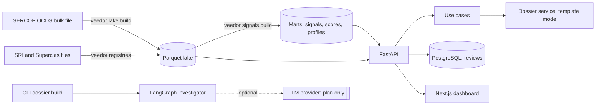

# Veedor

An open risk radar for public procurement in Ecuador. It computes transparent risk indicators over SERCOP's open contracting data, cross-checks winners against public registries, and writes an evidence dossier for each alert.

> *Indicadores de riesgo, con su evidencia.* (Risk indicators, with their evidence.)

**Status:** runs locally with Docker Compose, with ports bound to `127.0.0.1`. It is not deployed publicly. The data is not in this repository (see [Quickstart](#quickstart)).

In Ecuador a *veedor* is a citizen overseer: someone who watches a public process and reports what the records show. The tool is meant for that role.

## What it is, and what it is not

- **It is** a set of documented rules (10 risk indicators and 2 zero-weight context indicators) applied to every process, a score that adds the risk indicators up, and a dossier that shows, for each fired indicator, the value, the threshold and the source field.
- **It reports indicators, never accusations.** A fired indicator means a field is atypical under a stated rule. It does not mean anything improper happened. Single bidders, for example, are common in some procurement methods for ordinary reasons.
- **It is not a detector.** The evaluation below finds no evidence that the score singles out the one external list available.
- **Out of scope:** emergency procurement (absent from the open data) and catalogue purchases (no bidder data) are outside the competition analysis. Bidder and tender-window indicators never fire for them.
- Natural persons are masked in the API and the UI. Every dossier is a draft for human review.

## A real example

The dossier of a high-score process, built with `uv run veedor dossier build <ocid> --print --no-llm`. It is a 2018 works contract awarded by a small public entity to a company. **Names, RUCs and the OCID are withheld in this document**; they are replaced by `[entidad]` and `[proveedor]`. The text is Spanish because the product output is Spanish. The output is shown as generated, shortened.

| Indicator fired | Observed | Threshold |
|---|---|---|
| `SINGLE_BIDDER` | 1 bidder | 1 |
| `SHORT_TENDER_WINDOW` | 3.52 days | 4.04 days (5th percentile, same method and year) |
| `BUYER_CONCENTRATION` | 0.31 (31.3 % of the entity's awards that year; the largest single process is 15.8 %) | 0.3 |
| `CONTRACT_VS_COMPANY_SIZE` | 4.58 times the supplier's reported revenue of the previous year (2017) | 3 times |

Risk score: 60 out of 100 (weights 20 + 10 + 15 + 15).

```text
# Dossier [ocid]
Modo: template | verificación: aprobada (113 elementos comprobados) | intentos LLM: 0

El proceso [código] (Menor Cuantía) de la entidad [entidad], año 2018, presenta 4 señales de
riesgo: Oferente único; Plazo de ofertas atípicamente corto; Concentración de adjudicaciones
en un proveedor; Contrato desproporcionado frente a los ingresos del año anterior de la
empresa. Puntaje de riesgo: 60 sobre 100. Este documento es un borrador para revisión humana.

## Qué se contrató
Objeto según la clasificación CPC: «OTRAS OBRAS DE INGENIERIA CIVIL». La descripción
publicada por la entidad puede consultarse en el registro de origen.

## Señales detectadas
- Oferente único: El proceso recibió un solo oferente. Un solo oferente puede deberse a
  proveedores exclusivos; requiere verificación humana. Dato técnico: valor observado 1; umbral 1.
- Contrato desproporcionado frente a los ingresos del año anterior de la empresa: El monto
  adjudicado (USD 70.573,10) equivale a 4,58 veces los ingresos reportados por la empresa para
  2017 (USD 15.420,22); el umbral de la señal es 3 veces. Depende de los ingresos reportados a
  la Superintendencia de Compañías.

## Contexto comparativo
Procesos del mismo procedimiento (Menor Cuantía) y año (2018): 8.415.
Proporción de procesos con un solo oferente: 51,9 %.
```

Note the last line: in this method and year, about half of the processes have a single bidder. The dossier shows that context next to the indicator so a reader can discount it.

## Key numbers

All counts come from `data/marts/build_summary.json`, `eval/coverage.json` and `docs/DATA_SOURCES.md`, built on 2026-11-16.

| Item | Value |
|---|---|
| Processes analysed | 2,251,027 |
| Release dates | 2015-01-05 to 2026-11-09 (2026 is a partial year; a DuckDB query on the lake) |
| Catalogue purchases | 1,865,093 |
| Competitive | 267,037 |
| Direct | 95,445 |
| Without tender block | 19,862 |
| Other | 3,590 |
| Processes with at least one risk indicator | 87,217 (3.9 %) |
| Competitive processes with at least one risk indicator | 81,936 (30.7 %) |
| Processes with at least one context indicator | 658 |

Times each indicator fired:

| Indicator | Fired | Scope |
|---|---|---|
| `SINGLE_BIDDER` | 59,268 | competitive; method-category cells with no real competition are excluded |
| `RECURRING_COBIDDERS` | 11,417 | competitive |
| `CONTRACT_VS_COMPANY_SIZE` | 5,957 | winner has Superintendencia revenue for an earlier year |
| `LOW_SAVING` | 4,289 | competitive, method-years where it is evaluated |
| `REPEATED_DIRECT_AWARDS` | 3,361 | direct |
| `BUYER_CONCENTRATION` | 3,231 | non-catalogue; one process alone cannot reach 30 % |
| `SHORT_TENDER_WINDOW` | 3,092 | competitive with both dates |
| `NEW_SUPPLIER` | 1,307 | non-catalogue, company or public-entity winner in the SRI registry |
| `SUPPLIER_NOT_ACTIVE` | 16 | non-catalogue, company or public-entity winner, suspension before the process |
| `GHOST_COMPANY_LIST` | 0 | listing notified on or before the process date, company or public-entity winner |
| context: `CONTRACT_VS_COMPANY_SIZE_SAME_YEAR` | 614 | weight 0 |
| context: `GHOST_COMPANY_LISTED_LATER` | 44 | weight 0 |

Risk score distribution (weights are uncalibrated judgement calls; a score of 0 means "no indicator fired", not "low risk"):

| Score | Processes |
|---|---|
| 0 | 2,163,810 (96.125 %) |
| 10 to 25 | 83,229 |
| 30 to 45 | 3,961 |
| 50 or more | 27 |

Maximum 60; 99th percentile 20; 99.9th percentile 30.

Registry coverage (`docs/DATA_SOURCES.md`): the SRI registry matches 68,584 of 68,587 awarded RUCs; the Superintendencia de Compañías matches 15,401 of 19,847 awarded company RUCs; 16 awarded RUCs appear on the SRI "empresas fantasmas" list (1,113 RUCs in total). Registry-derived indicators (ghost list, supplier not active, new supplier, contract versus company size) are computed only for company and public-entity winners: attaching a registry qualification, tax status or start date to an identifiable individual would publish information about that person. The build summary records what this excluded (for example 1,291 `NEW_SUPPLIER` firings and 16 `SUPPLIER_NOT_ACTIVE` firings).

## Does it work? An honest evaluation

Short answer: **the available evidence does not show that the score singles out suppliers on the one external list we could use.** The full report is [docs/EVALUATION.md](docs/EVALUATION.md); this is the summary.

**Setup.** The only official outside label is the SRI list of "empresas fantasmas" (shell companies). Of its 1,113 RUCs, 9 are companies that won public contracts as process winner. We asked whether a score that excludes the indicators derived from the label ranks these 9 above the other 19,837 contract-winning companies.

| Result (held-out score, supplier mean, companies only) | Value |
|---|---|
| ROC-AUC (0.5 is chance) | 0.447 (95 % interval 0.303 to 0.598) |
| Permutation p-value, one-sided | 0.706 |
| Matched on method and year: stratified concordance (0.5 is no difference) | 0.387 (0.326 to 0.491) |
| Matched: observed / expected mean score | 0.44 (0.11 to 0.93) |
| Naive baseline, total amount awarded | AUC 0.525 (0.326 to 0.730) |

The headline interval includes 0.5. The matched comparison lies entirely below 0.5: if anything, the processes of the listed companies carry fewer indicators than comparable processes. None of the held-out variants has an interval entirely above 0.5.

**Why it cannot say more.**

- **Tiny positive set.** 9 companies. The intervals are wide, so a modest real effect cannot be ruled out either. This is absence of evidence, not evidence of absence.
- **The label measures tax behaviour, not procurement.** Being on the list is a tax-administration classification of a company, not a finding about a contract.
- **Positives are not independent.** The 44 processes of the 9 companies span 23 buyers; 11 of those processes (25.0 %) are at a single buyer, and 5 of the 9 companies share a buyer with another positive. The effective number of buyers is 10.9.
- **Unlisted does not mean clean.** The setting is positive-unlabelled, which pushes every metric toward chance.

**Analysis history (`eval/history.json`).** The evaluation was run four times on the same labels, and the rules changed in between:

| Run | What changed | Headline AUC (95 % CI) |
|---|---|---|
| 1 | Initial rules | 0.474 (0.315 to 0.661) |
| 2 | `SUPPLIER_NOT_ACTIVE` made time-aware (27,291 to 32 firings) | 0.474 (0.315 to 0.661) |
| 3 | Rules refined after review: `SINGLE_BIDDER` 74,964 to 59,268; `GHOST_COMPANY_LIST` 165 to 6 (159 moved to a context indicator); `BUYER_CONCENTRATION` 13,496 to 3,231; `CONTRACT_VS_COMPANY_SIZE` 4,023 to 5,957 | 0.447 (0.303 to 0.598) |
| 4 | Registry-derived indicators restricted to company and public-entity winners, for data-protection reasons | 0.447 (0.303 to 0.598) |

The rules were changed for correctness reasons found by review, and the project record says no rule was changed to move the metric. The metric moved down, not up, and the conclusion did not change. Even so, adjusting rules after looking at a metric on the same labels is a source of optimism: the labels are no longer a clean, independent test of the final rules. Read the latest figure as a descriptive check, not as an unbiased estimate of performance.

In earlier runs the full production score gave an inflated AUC because it contained the label itself; that was leakage, not skill. After the timing split the label-derived indicator almost never fires on the listed companies' own processes, and the production score gives the same AUC as the headline.

**A caution about naive readings.** Across all processes `SINGLE_BIDDER` has a ratio of 2.29 (interval 0.00 to 5.94) between listed and other companies; among non-catalogue processes it is 0.24 (0.00 to 0.46). Part of any all-process gap is method mix: 1 of the 44 processes of listed companies is a catalogue purchase, against 89.9 % of the others, and catalogue purchases cannot fire most indicators.

**A defect that tests did not catch.** Reading one dossier by hand showed a supplier flagged as not active that was still active when the process happened. The rule used the supplier's current SRI status. `SUPPLIER_NOT_ACTIVE` fired 27,291 times before the fix and 32 times after, because 27,259 of those suspensions came after the process date (it fires 16 times today, after the registry restriction described below). All automated tests were green before the fix. The rule is now time-aware (`docs/METHODOLOGY.md`).

**Three lessons from looking at things by hand.** Reading one dossier showed the `SUPPLIER_NOT_ACTIVE` defect above. An independent adversarial review broke guarantees (masking, and the trust placed in generated text) that the author believed were met, while every test was green; as a result the model stopped writing prose. And looking at one rendered process page showed a registry qualification attached to an identifiable individual, so registry-derived indicators are now computed only for companies and public entities.

**What this means.** The indicators are descriptive transparency measures that point to atypical features of a process for a human to look at. They are not validated predictors of wrongdoing, and no labelled set of proven problem contracts exists in the open data to test that. A high score is not an accusation.

## How it stays grounded

1. **Deterministic facts first.** Facts, indicators and registry matches are computed by code into an evidence pack. With no LLM configured, a template renders the dossier.
2. **The model does not write prose.** In LLM mode it receives a catalogue of fact ids and returns a plan: the order of fact ids per section, which context facts to include, one connective per section from a closed set and one reviewer note from a closed set. The renderer writes every sentence from the same templates as template mode. A plan with an unknown id, free text or more than one connective is rejected; after two failed attempts the template is used. The model cannot add or change a figure, name an entity, drop a risk signal, touch the limitations section or add a source. It can hide context facts and choose emphasis, so it can change what a reviewer reads first. That is all of its influence (`src/veedor/agents/investigator/README.md`).
3. **Grounding verifier, still applied.** Every number, date, RUC, code, spelled-out number and capitalised name in the rendered text must exist in the evidence pack, forbidden wording is rejected, and free text may appear only as a verbatim `« »` quote of the data. Unverified text is never stored or shown. The guarantee is structural rather than lexical: code writes every sentence, and the free-text process description is not loaded, not quoted in the dossier and not offered to the model ("Qué se contrató" uses the CPC classification and structured fields).
4. **The HTTP API never calls an LLM.** Dossiers served over HTTP are always template mode. LLM dossiers are produced only by the CLI, and no LLM variable is passed to the containers.
5. **Prompt-injection threat model.** Tender descriptions, names and registry text are written by third parties and can contain planted instructions. Untrusted strings travel only inside a delimited data block, with control characters removed and lengths capped, and the model has no tools or access to the lake, files or network. The structural defence is that the model's output is a plan over fact ids, not text.

**Known limits of the verifier.** It checks that values exist in the evidence, with field binding only for values that follow a known label. A bare figure that follows no label is checked by membership only, only capitalised names are detected, and meaning is not checked: a true figure used in a misleading sentence would pass. Constrained generation reduces that exposure for LLM output because the model no longer writes sentences.

**Real-model results** (`eval/llm_grounding_runs.json`, model `gpt-5.4-mini`, "top 20 by risk score" in each run, one run each, small samples):

| Run | Passed first attempt | Passed after retry | Fell back to template | LLM calls | Prompt / completion tokens | Median latency |
|---|---|---|---|---|---|---|
| 1. Free prose under the strict verifier (field binding, prompt v1) | 2 | 5 | 13 | 38 | 67,340 / 22,643 | 6,184 ms |
| 2. Constrained generation (model selects fact ids, renderer writes all text) | 5 | 9 | 6 | 35 | 73,924 / 6,107 | 2,673 ms |

In both runs all 20 final dossiers passed grounding, because failures fall back to the template. The file does not state that the two runs used the same 20 processes. Even with constrained generation, 6 of 20 plans were still rejected twice and fell back to the template.

## Architecture

Parquet files hold the read-only analytics data and DuckDB queries them in memory. PostgreSQL holds only human reviews, which are disabled by default. The API serves masked responses and the Next.js dashboard renders them.



**Layer rule.** `domain` (indicators, scoring, dossier templates, grounding verifier, masking) imports nothing from the other layers. `use_cases` depend on `domain` and on ports; `infrastructure` implements the ports; `api` and `cli` only call use cases. One known deviation is documented in `docs/ARCHITECTURE.md`.

| Piece | What it does |
|---|---|
| Python 3.12, uv, ruff, pytest | language, packaging, lint, tests |
| DuckDB + Parquet | read-only analytics; indicators are set-based SQL |
| scikit-learn | Isolation Forest anomaly score, reported separately and never part of the risk score |
| FastAPI + Pydantic | API and response models, where masking is applied |
| LangGraph | dossier graph: load evidence, assess, plan, render, verify, finalize or fall back |
| PostgreSQL (pgvector image) + SQLAlchemy + Alembic | human reviews |
| Typer | the `veedor` command line |
| Next.js 16, React 19, Tailwind 4 | dashboard |
| Docker Compose | local stack: web, api, db, one-off migration |

## Security summary

Full threat model and findings: [docs/SECURITY.md](docs/SECURITY.md).

- **SQL injection.** All values are bound parameters. The only variable SQL text is the sort column, taken from a closed mapping. Path and query parameters are validated and bounded.
- **DuckDB lockdown.** Each query runs in a fresh in-memory connection with views over known Parquet files only, `allowed_directories` restricted, external access disabled, configuration locked and only `SELECT`/`WITH` accepted.
- **Masking of natural persons.** A RUC whose third digit is 0 to 5 is a natural person: the name becomes "Persona natural" and the RUC keeps four digits. A party with no usable RUC is masked unless its name carries a legal-entity marker (default is to mask). Free-text descriptions are withheld when they contain personal identifiers, including 10-digit cédulas. Supplier pages of natural persons return the same 404 as an unknown RUC. Masking is applied in the response models.
- **Limits, stated plainly.** Name masking in free text is heuristic: a name that is neither a known party of the process nor preceded by an honorific can still appear in a description shown by the process detail page. Dossiers do not quote descriptions. **The data directory and the Parquet files contain unmasked personal data (names, RUCs, cédulas) and must never be published or shared as-is.** Masking exists only at the API boundary.
- **Reviews are disabled by default.** Writing a review requires `VEEDOR_REVIEWS_ENABLED=true` and a bearer token. The token is one shared secret, not a per-user identity. There is still no user authentication, so do not expose the API to the internet. The rate limiter is per process.
- **Ports** (web 3000, api 8000, PostgreSQL 5433) are bound to `127.0.0.1`.

### Independent review

After the first build, an independent adversarial read-only review was run against the system. Its findings, recorded in `docs/REVIEWS.md` and `docs/SECURITY.md`, concerned masking and API behaviour: personal data leaking through free text, parties without a RUC never masked, an oracle for natural-person suppliers, search by a person's name, an unhandled error on the dossier endpoint, anonymous callers able to trigger paid LLM calls and unbounded cache writes, open and unvalidated review writes, oversized `page` values causing server errors, and PostgreSQL published on all interfaces with a default password. The document lists no finding against the SQL-injection defences or the DuckDB lockdown. All listed findings are marked fixed. The grounding verifier was also hardened (hidden and look-alike characters, figure binding) and the model stopped writing prose.

A second reviewer then re-tested every finding and tried to bypass each fix. It confirmed the high-severity items fixed and ran a privacy sweep over 1,640 processes (3,280 API responses, plus the page source of 20 web pages): 0 leaked names, 0 unmasked natural-person RUCs, 0 valid cédulas. It also found new, smaller defects — over-masking that damaged some hospital names in dossiers, a burst of transient file-open errors surfacing as HTTP 500, and a weaker wording filter on the (disabled-by-default) review path — and showed that the forbidden-word list alone is easy to evade (35 of 82 fresh evasions passed it), which is why the guarantee for dossier text is structural rather than lexical. Those items were fixed afterwards; that last round was verified by the project's own tests and sweeps, not by a third independent review.

The first review also confirmed what held: 40 SQL-injection payloads across every parameter and 19 attempts to read or write outside the data folders had no effect. The full record of both reviews, including what remains open, is in [`docs/REVIEWS.md`](docs/REVIEWS.md).

## Quickstart

**Prerequisites:** Docker with Compose v2; [uv](https://docs.astral.sh/uv/) and Python 3.12 to run the CLI and tests; free ports 3000, 8000 and 5433 on localhost.

**The `data/` folder is not in the repository.** The API needs `data/lake/` and `data/marts/`, so build them first (below) or restore a data bundle (`make bundle` creates one; `docs/DEPLOYMENT.md`). A bundle holds unmasked personal data: do not publish it.

```bash
uv sync
docker compose up -d --build --wait     # or: make up
uv run python scripts/smoke_test.py     # or: make smoke
```

| Service | URL |
|---|---|
| Web dashboard | http://localhost:3000 |
| API and docs | http://localhost:8000, docs at `/docs` |
| PostgreSQL | localhost:5433 |

The smoke test runs 12 checks and writes nothing: on the current local stack the result is `12/12 checks passed`, including a refused anonymous review write and no stored review row. Dossiers are in template mode unless you run the CLI with an LLM configured (`docs/CONFIGURATION.md`).

**Rebuild the data** (about 1 minute for the lake and 4.7 seconds for the marts on the development machine; the registry download was not timed):

```bash
uv run veedor lake build                # needs data/raw/sercop_ocds_full.jsonl.gz
uv run veedor registries download
uv run veedor registries load
uv run veedor signals build
uv run veedor evaluate backtest         # optional, then: evaluate coverage, evaluate report
```

## Project layout

```text
src/veedor/
  core/  domain/  use_cases/  infrastructure/  agents/investigator/
  api/  schemas/  cli/  evaluation/
tests/        mirrors src; synthetic fixtures only, no network
web/          Next.js dashboard
eval/         back-test, coverage, history and LLM-run outputs
docs/         CONTRACT, METHODOLOGY, EVALUATION, ARCHITECTURE, DATA_SOURCES,
              DEPLOYMENT, SECURITY, CONFIGURATION, BRAND
scripts/      smoke test, data bundle
```

## Testing

```bash
uv run pytest -q
uv run ruff check src tests scripts
```

Results of the last run (`uv run pytest -o addopts=""`, `uv run ruff check src tests scripts`, `uv run python scripts/smoke_test.py`): **682 passed**; ruff **all checks passed**; smoke test **12/12 checks passed** against the local stack. Tests use small synthetic fixtures and never need the real data.

## Known limitations

- **Detail pages for some processes cannot be opened.** 891 of 2,251,027 processes (0.04 %) have characters in their identifier (spaces, slashes, dashes, Ñ, commas) that the strict identifier validation rejects.
- No evidence that the score singles out any external reference list (see the evaluation).
- Registry facts are current, not historical; the signals that use them say so.
- Emergency procurement is absent from the open data and untested.
- No user authentication; free-text name masking is heuristic.

## Roadmap

- EcuDataMCP live lookups: a client port exists, it is not wired.
- Legal-text retrieval: deliberately postponed.
- Real user authentication for reviews, and a shared rate limiter.
- Calibration of the weights, which needs better labels than the SRI list.
- Emergency-procurement data, if it becomes available.
- A way to open the 891 processes with unusual identifiers.

## Data sources and licences

All data is public and was retrieved on 2026-11-16 (`docs/DATA_SOURCES.md`).

| Source | Licence |
|---|---|
| SERCOP open contracting data, via the Open Contracting Data Registry | CC BY 3.0 EC |
| SRI RUC registry and "empresas fantasmas" list | not stated on the listing page |
| Superintendencia de Compañías directory and financials | not stated |

"Not stated" is not a statement that reuse is unrestricted. Confirm terms before redistributing the data or derived tables.

## Disclaimer

Veedor muestra indicadores de riesgo calculados sobre datos públicos. No constituyen acusaciones ni determinan responsabilidades. (Veedor shows risk indicators computed on public data. They are not accusations and do not determine responsibility.)

## Licence

Code: MIT, see [LICENSE](LICENSE). Contributions: [CONTRIBUTING.md](CONTRIBUTING.md).

## Author

Luis Figueroa ([github.com/DweskZ](https://github.com/DweskZ)), creator of EcuDataMCP.
