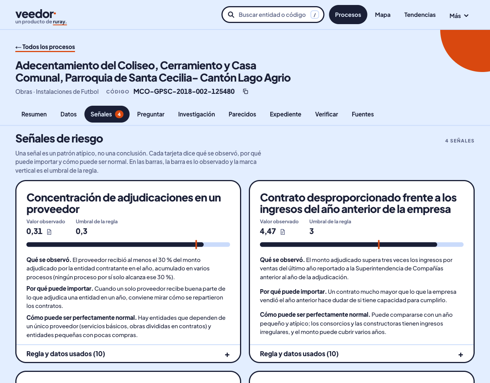
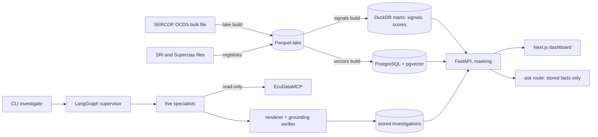

# Veedor

An open procurement risk radar for Ecuador: it reads the open data of public procurement (SERCOP, OCDS), computes rule-based risk indicators, and lets you explore them, with LLM agents that gather evidence and a question box that answers only from stored facts. *Un producto de [ruray](https://ruraytech.com).*

  

Live demo: <https://veedor.ruraytech.com>

| Home | A process dossier |
|---|---|
|  |  |

In Ecuador a *veedor* is a citizen overseer: someone who watches a public process and reports what the records show.

SERCOP publishes the data; Veedor says what to look at and why. Every alert comes from a rule anyone can inspect, and an alert means a field is atypical under that rule, never an accusation.

## What this project demonstrates

- **Data engineering.** 2.25 million records from a bulk open-data file into a Parquet lake, with set-based SQL indicators in DuckDB.
- **LLM agents with guardrails.** A LangGraph supervisor and five specialists that use read-only tools, including [EcuDataMCP](https://github.com/DweskZ/EcuDataMCP), an MCP server for Ecuadorian open data by the same author. The model selects fact ids, code renders the text, and a grounding verifier checks it.
- **Measurement that states its limits.** Held-out sets frozen by hash, a pre-registered validation, and the limits written next to each result.
- **Full stack and operations.** FastAPI, PostgreSQL with pgvector, Next.js, Docker Compose, GitHub Actions CI and Terraform.

Details and code paths are in [Engineering highlights](#engineering-highlights) and [Stack](#stack).

## What it does

- Reads **2,251,027 procurement processes** (2015 to 2026) from SERCOP's open contracting data into a Parquet lake queried with DuckDB (`data/marts/build_summary.json`, `eval/coverage.json`).
- Defines **10 risk indicators and 2 zero-weight context indicators** (`src/veedor/domain/signals/definitions.py`). In the data, 9 of the 10 fire at least once (`GHOST_COMPANY_LIST` never does) and both context indicators do; 87,217 processes (3.9 %) fire at least one risk indicator (`eval/coverage.json`).
- Writes a **dossier per process**: for each fired indicator, the value, the threshold and the source field, next to the typical value for the same method and year, and how close the budget sits to the procedure threshold of that year (context only; it changes no score).
- Runs a **supervisor and five specialist agents** (LangGraph) that add registry, history, audit and question-and-answer facts for a flagged process through read-only tools, including the author's own MCP server, [EcuDataMCP](https://github.com/DweskZ/EcuDataMCP). The fifth runs only when the process has stored texts.
- Serves a **Next.js dashboard** (process page with tabs, province map, trends, a validation section) with similar-process search (365,864 processes in a pgvector index) and a question box that answers only from stored facts (off by default).

One real dossier, with names withheld (a 2018 works contract; full text in [REFERENCE.md](docs/REFERENCE.md#a-real-example)):

| Indicator fired | Observed | Threshold |
|---|---|---|
| `SINGLE_BIDDER` | 1 bidder | 1 |
| `SHORT_TENDER_WINDOW` | 3.52 days | 4.04 days (5th percentile, same method and year) |
| `BUYER_CONCENTRATION` | 0.31 | 0.3 |
| `CONTRACT_VS_COMPANY_SIZE` | 4.58 times the supplier's previous-year revenue | 3 times |

The dossier also states that about half of the processes of that method and year have a single bidder (51.9 %), so a reader can discount the indicator.

## What it deliberately does not do

- **It does not accuse.** A fired indicator means a field is atypical under a stated rule. Veedor does not detect corruption and never says that anything improper happened.
- **It shows no natural persons.** They are masked at the API; quotes from process text are off by default.
- **What was tested, what it showed, what it does not show.** Two tests, both documented in [VALIDATION.md](docs/VALIDATION.md).
  - *Tax-authority list* (9 winning companies against 19,837 others; the official list has 1,112 taxpayers, companies and natural persons): ROC-AUC 0.447 (95 % interval 0.303 to 0.598). With 9 positives the test could only detect an AUC of about 0.77 or more, so it is **inconclusive**, not a verdict on the score.
  - *Savings*, pre-registered, explored on 2015 to 2021 and confirmed on 2022 to 2026 (76,677 competitive processes with a budget and an award), after adjusting for method and year, product class, province and budget: processes with a single bidder save about 8.3 percentage points of the budget less, a short tender window 1.5 less, a new supplier 1.4 less; recurring co-bidders show no difference; two indicators cannot be tested; three that use the award amount are reported apart because the comparison is partly circular. The composite without those three has a rank correlation of about -0.15 with the saving.
  - *What this does not show:* that a low saving is wrongdoing (with one bidder there is little price competition, so part of this is by definition), anything about a single process, or that the score identifies corrupt contracts. The effect is small in rank terms and no labelled set of proven problem contracts exists.

## Engineering highlights

1. **Constrained generation.** In LLM mode the model never writes prose: it receives a catalogue of fact ids and returns a plan (ids in order, one connective from a closed set). Code renders every sentence from templates, and a grounding verifier checks each number, date, RUC and name against the evidence pack, falling back to the template after two failures. Real-model run: 6 of 20 plans still fell back (`eval/llm_grounding_runs.json`). Code: `src/veedor/domain/dossier/`; see [AGENTS.md](docs/AGENTS.md).
2. **Evaluation that corrected itself.** Question answering was first measured on phrasings written with the retrieval keys (recall 83.7 % on the original phrasings). An independent review wrote its own wording: 14.2 %. Retrieval was rebuilt twice (an intent layer, then a fix for out-of-scope questions) and measured on separate phrasing sets, with held-out sets frozen by hash and run once. Recall now: original 97.2 %, development 87.0 % (tuned on, optimistic), held-out 1 89.1 % (measured on the earlier version, not re-run), **held-out 2 78.4 % (76.5 to 80.3), one run**, with 88.7 % abstention on unanswerable questions (105 of 930 got a wrong fact). Attack successes: 0 in every set, including a new adversarial set of 408 questions. In model mode (`gpt-5.4-mini`, in-vocabulary phrasings, 172 questions) the model abstained on all 40 unanswerable ones but recalled less than retrieval alone (87.5 % against 95.0 % on the same questions); small sample. Code: `src/veedor/evaluation/`, [EVALUATION.md](docs/EVALUATION.md).
3. **Pre-registered validation.** The analysis plan for the savings test was written and hashed before any saving was computed; learning and deciding used different periods, p-values are corrected across the signal family, intervals resample buyers, and each result states the smallest effect the test could detect. Deviations are recorded, not edited into the plan. Code: `src/veedor/evaluation/`, [VALIDATION.md](docs/VALIDATION.md), [THRESHOLDS.md](docs/THRESHOLDS.md).
4. **Privacy as a release gate.** Third-party text passes a deny-by-default screen, and a script fails the data bundle build when any stored passage matches the reviewer's or the project's rules. Quotes stay off unless built `--with-quotes`. Measured residual: of 150 passages read from the final mart, none named a person (95 % upper bound 2.0 %; 0 of 300 over two rounds, 1.0 %). That is a sample read by one reader, not a guarantee (`docs/QUOTES.md`). Code: `src/veedor/domain/quotes/`, `scripts/check_quotes_privacy.py`.
5. **Adversarial reviews.** Five independent, read-only reviews, each started without knowledge of the code, run on a suite that was fully green. They broke masking, the text verifier, the investigation API in compose, the first quote screen (persons in stored quotes), the deploy role and the rate limit, and the fixes are recorded. The last one concluded the project was not fit to publish until they were fixed. See [REVIEWS.md](docs/REVIEWS.md).
6. **HTTP caching without a cache service.** Weak ETag and `Cache-Control` by route class, `304` before the route runs, caches warmed at start; no Redis, and [DEPLOYMENT.md](docs/DEPLOYMENT.md#caching) says why and when that would change.

## Stack

| Skill | Where it lives |
|---|---|
| Python 3.12, uv, ruff, pytest | `pyproject.toml`, `tests/` |
| FastAPI, Pydantic | `src/veedor/api/`, `src/veedor/schemas/` (masking in response models) |
| HTTP caching (ETag, Cache-Control, 304) | `src/veedor/api/http_cache.py`, [SECURITY.md](docs/SECURITY.md#http-caching-headers) |
| SQLAlchemy + Alembic | `src/veedor/infrastructure/db/`, `alembic/versions/` |
| PostgreSQL + pgvector (HNSW) | `docker-compose.yml`, `alembic/versions/0002_create_process_vectors.py`, `src/veedor/infrastructure/vectors/` |
| DuckDB + Parquet | `src/veedor/infrastructure/lake/` (set-based SQL indicators) |
| scikit-learn (Isolation Forest) | `src/veedor/infrastructure/lake/marts_builder_anomaly.py` (reported separately, not in the score) |
| Local embeddings (fastembed) | `src/veedor/infrastructure/vectors/`, [VECTOR_SEARCH.md](docs/VECTOR_SEARCH.md) |
| LangGraph multi-agent supervisor | `src/veedor/agents/investigation/`, [AGENTS.md](docs/AGENTS.md) |
| MCP client | `src/veedor/infrastructure/mcp/` |
| RAG with grounding | `src/veedor/domain/dossier/`, `src/veedor/domain/qa/` |
| LLM evaluation, statistical validation | `src/veedor/evaluation/`, `eval/`, [EVALUATION.md](docs/EVALUATION.md), [VALIDATION.md](docs/VALIDATION.md) |
| Prompt-injection defences | `src/veedor/domain/investigation/`, `tests/agents/test_investigator_injection.py` |
| OpenTelemetry + Grafana | `src/veedor/infrastructure/telemetry/`, `ops/observability/`, [OBSERVABILITY.md](docs/OBSERVABILITY.md) |
| Next.js 16, TypeScript, Tailwind CSS | `web/` |
| Playwright + axe (Chromium, Firefox, WebKit, phone viewport) | `web/e2e/` (run locally with `pnpm test:e2e`; not in CI) |
| Docker Compose | `docker-compose.yml`, `deploy/` |
| GitHub Actions CI | `.github/workflows/ci.yml` (ruff, migrations, pytest), `deploy.yml` (manual deploy) |
| Terraform (AWS EC2, IAM OIDC, SSM) | `infra/terraform/`, [DEPLOYMENT_AWS.md](docs/DEPLOYMENT_AWS.md) (applied once to a live project on 2026-11-17; the GitHub OIDC deploy role was not created there, see the first-deployment note) |
| Caddy | `deploy/Caddyfile` |

## Architecture



- `domain/`: indicators, scoring, dossier templates, grounding verifier, masking. Imports nothing from the other layers.
- `use_cases/`: application services; they depend on `domain` and on ports (`use_cases/queries/ports.py`).
- `infrastructure/`: implements the ports (lake, registries, db, llm, mcp, vectors, telemetry).
- `agents/`: the LangGraph dossier graph and the investigation supervisor and specialists.
- `api/` and `schemas/`: FastAPI routers and Pydantic response models; `cli/`: Typer commands. Both only call use cases.
- The HTTP API serves stored records and never starts an investigation; the only route that can call an LLM is the question box (`POST /processes/{ocid}/ask`), where the model only selects stored fact ids. The layer rule holds for `domain` and the query use cases; the places where it does not (four use cases that wire infrastructure, two ports declared on the infrastructure side, three routers that skip the use-case layer) are listed in [ARCHITECTURE.md](docs/ARCHITECTURE.md).

## Run it locally

Needs Docker with Compose v2, [uv](https://docs.astral.sh/uv/) and Python 3.12. **The data lake is not in the repository**: the API needs `data/lake/` and `data/marts/`. Build them (below) or restore a bundle (`make bundle`, [DEPLOYMENT.md](docs/DEPLOYMENT.md)); a bundle holds unmasked personal data, so do not publish it.

```bash
uv sync
uv run veedor lake build                # needs data/raw/sercop_ocds_full.jsonl.gz, about 1 min
uv run veedor registries download && uv run veedor registries load
uv run veedor signals build             # about 5 s
docker compose up -d --build --wait     # or: make up; web :3000, api :8000
uv run python scripts/smoke_test.py     # or: make smoke
```

Vector index and investigations (`make db-up`, then `uv run alembic upgrade head`): `uv run veedor vectors build`, `uv run veedor investigate run <ocid> --no-llm`. Ports are bound to `127.0.0.1`. Full commands, `make` targets and configuration: [REFERENCE.md](docs/REFERENCE.md), [CONFIGURATION.md](docs/CONFIGURATION.md).

## Results and limits

| Measure | Value | Source |
|---|---|---|
| Processes analysed | 2,251,027 | `eval/coverage.json` |
| Processes with at least one risk indicator | 87,217 (3.9 %) | `eval/coverage.json` |
| Score vs tax-authority shell-company list, ROC-AUC (9 positives, inconclusive) | 0.447 (0.303 to 0.598) | `eval/backtest.json`, [VALIDATION.md](docs/VALIDATION.md) |
| Savings, 2022 to 2026: single bidder, adjusted | -8.3 points of budget (-8.8 to -7.8) | `eval/validation.json` |
| Savings: short tender window / new supplier, adjusted | -1.5 (-1.9 to -1.0) / -1.4 (-2.5 to -0.3) | `eval/validation.json` |
| Composite without award-based indicators, rank correlation with saving | -0.15 (-0.16 to -0.14) | `eval/validation.json` |
| Procedure thresholds | 11 years verified from official sources (2015 to 2024, 2026; 2025 excluded); 5 thresholds with a bunching estimate | [THRESHOLDS.md](docs/THRESHOLDS.md), `eval/validation.json` |
| Question answering recall, held-out 2 (one run) | 78.4 % (76.5 to 80.3); abstention 88.7 %; attack successes 0 | `eval/qa.json` |
| Question answering, model mode (172 questions, in-vocabulary) | recall 87.5 % vs 95.0 % retrieval only; 0 of 40 unanswerable answered | `eval/qa.json` |
| Similar-process agreement, description only, 20,000 pool | 29.8 % vs 2.4 % random | `eval/vector_search.json` |
| Investigations, no model / model-assisted | 20 / 10, no errors | `eval/investigations_run.json` |
| Web end-to-end suite | 7 spec files, 4 browser projects, axe; local only | `web/e2e/` |

Limits, in plain words: the score is weakly associated with lower savings for three indicators and is not validated against any corruption outcome, which the open data does not contain. The tax-authority label set is 9 companies and measures tax behaviour, not procurement. The bunching estimate describes the distribution of budgets and does not say why purchases sit where they do. Question answering on unseen wording recalls 78 %, and its held-out figures come from sets whose independence is limited (same author). Registry facts are snapshots of today. Emergency procurement is absent from the open data. Name masking in free text is heuristic, and there is no user authentication: the public demo serves anonymous read routes only, with reviews, quotes, the question box and `/docs` switched off, and read routes have only a per-IP, in-memory, per-worker rate limit (a distributed client is not stopped, visitors behind one NAT share a bucket, and it is off unless configured; the production compose file sets it). Do not enable a write route on an internet-facing deployment before adding real authentication ([SECURITY.md](docs/SECURITY.md#not-covered-yet)). The model-assisted investigation run predates the last fixes, the later work (intent retrieval, validation, thresholds, caching) was not independently reviewed, and no model behaviour was reviewed adversarially with a real model. More: [REFERENCE.md](docs/REFERENCE.md#known-limitations).

## Documentation

- **Method and evidence:** [METHODOLOGY.md](docs/METHODOLOGY.md), [EVALUATION.md](docs/EVALUATION.md), [VALIDATION.md](docs/VALIDATION.md), [THRESHOLDS.md](docs/THRESHOLDS.md), [DATA_SOURCES.md](docs/DATA_SOURCES.md), [VECTOR_SEARCH.md](docs/VECTOR_SEARCH.md).
- **Design:** [ARCHITECTURE.md](docs/ARCHITECTURE.md), [AGENTS.md](docs/AGENTS.md), [OBSERVABILITY.md](docs/OBSERVABILITY.md), [BRAND.md](docs/BRAND.md).
- **Safety and review:** [SECURITY.md](docs/SECURITY.md), [QUOTES.md](docs/QUOTES.md), [REVIEWS.md](docs/REVIEWS.md).
- **Operations:** [CONFIGURATION.md](docs/CONFIGURATION.md), [DEPLOYMENT.md](docs/DEPLOYMENT.md), [DEPLOYMENT_AWS.md](docs/DEPLOYMENT_AWS.md).
- **Build contracts:** [CONTRACT.md](docs/CONTRACT.md), [V2](docs/CONTRACT_V2.md), [V3](docs/CONTRACT_V3.md), [V4](docs/CONTRACT_V4.md).
- **Moved from this README:** [REFERENCE.md](docs/REFERENCE.md) (example dossier, key numbers, agents, performance, full commands, roadmap), [HISTORY.md](docs/HISTORY.md) (first question-answering measurement, review summary table).

## Resumen en español

Veedor es un radar abierto de riesgo en la contratación pública del Ecuador. Lee los datos abiertos del SERCOP (OCDS): 2.251.027 procesos entre 2015 y 2026. Calcula 10 indicadores de riesgo con reglas documentadas y muestra, para cada proceso, el valor, el umbral y el campo de origen. Un conjunto de agentes con modelos de lenguaje reúne evidencia adicional de fuentes públicas, y una caja de preguntas responde solo con hechos almacenados. Veedor no acusa ni detecta corrupción: un indicador solo señala que un dato es atípico según una regla. No muestra personas naturales. Se probó contra dos referencias. La lista de empresas fantasma del SRI (9 empresas adjudicatarias) no permite concluir nada: la prueba solo detectaría un AUC de 0,77 o más y el resultado fue 0,447. En una prueba preregistrada contra el ahorro (explorada en 2015-2021, confirmada en 2022-2026), los procesos con un solo oferente ahorran unos 8,3 puntos del presupuesto menos; es una asociación débil, en parte por definición, y no dice que haya algo indebido. Funciona en local con Docker Compose y tiene una demo pública en <https://veedor.ruraytech.com>. Los datos no están en el repositorio; la guía para construirlos está en este archivo y en `docs/DEPLOYMENT.md`.

## Data sources and licences

All data is public and was retrieved on 2026-11-16 ([DATA_SOURCES.md](docs/DATA_SOURCES.md)). SERCOP open contracting data (via the Open Contracting Data Registry): CC BY 3.0 EC. SRI registry and "empresas fantasmas" list, and Superintendencia de Compañías directory and financials: licence not stated. "Not stated" is not a statement that reuse is unrestricted; confirm terms before redistributing data or derived tables.

Veedor muestra indicadores de riesgo calculados sobre datos públicos. No constituyen acusaciones ni determinan responsabilidades. (Veedor shows risk indicators computed on public data. They are not accusations and do not determine responsibility.)

## Licence and contact

Code: MIT, see [LICENSE](LICENSE). Contributions: [CONTRIBUTING.md](CONTRIBUTING.md).

Luis Figueroa ([github.com/DweskZ](https://github.com/DweskZ)), creator of [EcuDataMCP](https://github.com/DweskZ/EcuDataMCP).
