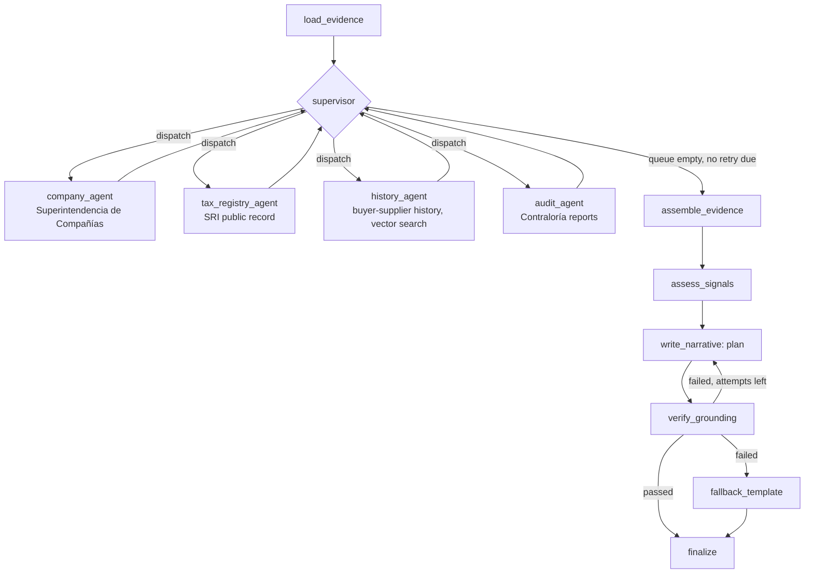

# Multi-agent investigation

A supervisor and four specialists gather extra evidence about a flagged process through read-only
tools, then the evidence flows through the same renderer and grounding verifier as the stage-1
dossier. Investigations are produced by the CLI and stored; the HTTP API only serves stored ones.

```bash
veedor investigate run <ocid> [--no-llm] [--offline] [--print]
veedor investigate batch --top 20 [--no-llm] [--offline] [--max-model-calls 60]   # writes eval/investigations_run.json
veedor investigate show <ocid>
GET /api/v1/processes/{ocid}/investigation        # stored record, masked; 404 when none; never runs anything
```

## Graph



Each specialist is itself a LangGraph subgraph: `choose` (order the enumerated actions) then `act`
(run one action, loop). Without a model, `choose` returns the fixed default sequence.

## Agents

| Agent | Objective | Tools (allow-list) | Budget | On failure |
|---|---|---|---|---|
| Supervisor | Decide which specialists run, in what order, with a reason from an enumeration. | none | 6 dispatches per investigation, a specialist at most twice | Invalid model choice: one retry, then the deterministic table. |
| `company` | Facts of the company winner: incorporation date and days to the process date, subscribed capital and the award/capital multiple, legal status, last balance year, latest fiscal year with financial statements (employees, equity, assets). | `get_compania_info`, `get_financials` (EcuDataMCP) | 4 calls | Fact becomes "no disponible (la fuente no respondió)"; the source says so in the section "Investigación realizada". |
| `tax_registry` | Live SRI public record: status, taxpayer class, size category, activity start, whether it agrees with the downloaded table. | `get_sri_ruc_info` with `include_establecimientos=false` | 4 calls | Same. |
| `history` | Other awards between this buyer and supplier at any date (count, amount) and same-buyer similar purchases within ±180 days among the 50 nearest neighbours of the vector index. | `pair_awards` (lake), `similar_processes` (`find_similar` + lake dates) | 4 calls | Vector index missing: `upstream_error`/`skipped` with a closed reason; the rest still runs. |
| `audit` | Contraloría approved-report rows whose audited entity equals the buyer by a normalised-name comparison. | `list_catalogo(fuente="contraloria")`, `get_contraloria_informe` | 4 calls (catalogue + 3 files) | "No se pudo establecer" when matching is unreliable or coverage is partial; never a weak match. |

### Dispatch policy (no model)

Signal-driven specialists first, in the order of the table in `domain/investigation/policies.py`
(for example `NEW_SUPPLIER` → company, tax_registry; `BUYER_CONCENTRATION` → history, audit;
`SHORT_TENDER_WINDOW` → audit), then the remaining applicable specialists in the order company,
history, audit, tax_registry. These weights are judgement calls, like the score weights. A specialist
whose call ended in a timeout is dispatched once more (reason `retry_after_transient_failure`), only
for the failed action, within budget. Registry specialists are applicable only when the winner is a
company or public entity (RUC third digit 9 or 6) and the RUC is not masked.

### Model-driven variant

With a model configured, the supervisor and each specialist with at least two actions make one
call (plus one retry on an invalid reply). The reply is a JSON object validated against closed
enumerations (`{"dispatch": [{"specialist", "reason"}]}`, `{"actions": [ids]}`); names, reasons,
action ids and budgets are checked in code. Prompts contain only signal codes, specialist names,
action ids and counters: never an entity name, RUC or any tool text. A hard cap on model calls is
shared by the whole batch (`--max-model-calls`); beyond it every decision falls back to the policy.

## What the model can and cannot influence

Can: the order and subset of specialists (within the enumerations and budgets), the order and
subset of a specialist's actions, and, as in stage 1, the plan of the dossier (which facts, order,
one connective, one note). Cannot: write any sentence, pass any argument to a tool, name a target
that is not `winner`, `buyer` or `process`, add a tool, exceed a budget, hide the section
"Investigación realizada" (the plan cannot name it) or any failure listed in it, touch the
limitations section, see a string that came from a tool.

## Threat model for tool results

Tool results are untrusted data (a registry, a PDF-derived CSV and an upstream web page are all
writable by third parties).

1. **Allow-list**: `ToolRunner` refuses any tool not in the specialist's list (logged as `skipped`,
   reason `tool_not_allowed`); it is the only code path that calls a backend.
2. **Arguments are built by code** from the pack (`targets.py`), after strict patterns (RUC,
   ocid). The one value that originates in a result is a Contraloría file id: it must match
   `^[0-9]{1,6}$` and come from a catalogue entry whose label starts with "Informes aprobados".
3. **Typed parsing**: every result is validated by a pydantic model that declares only the fields
   used, ignores all others (a legal representative's name, address and phone are never declared,
   so they are dropped at validation), caps string lengths and sizes, and checks that the returned
   RUC equals the requested one. A failure is `invalid_result`.
4. **Closed vocabularies**: legal status, SRI status, taxpayer class, size category and report type
   are mapped to enumerations; anything else becomes `other`. Numbers and dates are parsed, not copied.
5. **Free text**: the only free string kept is a Contraloría report title, screened (personal-data
   masking, forbidden-wording and instruction screens), capped, shown as an attributed quotation in a
   fact the model catalogue replaces with `«[cita de la fuente omitida]»`. Report entity names are
   used only for comparison in code.
6. **Natural persons**: no registry lookup for them; names of legal representatives are never
   declared, stored, shown, logged or sent to a model; derived facts hold counts and flags only. The
   store refuses to write a record containing a natural-person RUC.
7. **Logs and telemetry** hold ocid, specialist, tool, outcome, counts and durations only; MCP server
   logs are sent to `/dev/null`; error texts are read only to choose a closed reason and are dropped.
8. The grounding verifier still checks every sentence; new facts have bindings for their labelled
   figures (capital, equity, assets, employees, accumulated amount, days, multiples).

## The Contraloría objective, and its limit

`get_contraloria_informe` returns at most 200 rows per file and flags `truncated: true`; the
catalogue lists 8 approved-report files for 2022-2024. Matching is exact on a canonical key (accents,
case, punctuation, filler words, "GAD / Gobierno Autónomo Descentralizado / Municipio" variants
collapsed; no prefix or containment) and a key shared by two buyers in the data is ambiguous and
never matches. The audit specialist reads 3 files (budget), so it can confirm "at least N reports"
but cannot rule any out: the usual statement is "no se pudo establecer", with the rows examined.

## Stored record

`data/investigations/<ocid>.json`: specialists run (reason, who decided, outcomes, fact ids added),
the tool log (tool, target reference, start/end, duration, outcome, attempts, closed reason), the
facts added, the final dossier and model usage (calls, tokens, rejected choices). No identifiers of
targets are stored.

## Rules added after the independent review

- **Privacy guard.** The store refuses a record only when a *string value* holds a natural person's RUC
  as a whole token (a `.`/`,` next to the digits makes it a number, not an identifier). A genuine hit
  does not crash: the record is stored with `withheld = "personal_data_guard"`, no dossier and no
  fact list; the CLI exits cleanly. Floats are rounded where they are produced (amounts to cents,
  grounding-report values to 4 decimals).
- **File names.** `data/investigations/<sha256(ocid)>.json` (the ocid stays inside the record), so
  every real identifier works; the CLI only rejects an empty, over-long or control-character id.
  The dossier cache keeps readable names for safe ids and hashes the rest.
- **Fiscal year.** Financial figures come from the latest fiscal year strictly before the process
  year, and the sentence says which year; if none exists it says so.
- **Plausibility** (`domain/investigation/bounds.py`): dates 1900-01-01 to the day of the query,
  amounts up to USD 1e12, 1 to 1,000,000 employees; anything else renders as "no disponible (valor
  fuera de rango en la fuente)" and the tool call gets the reason `out_of_range`. A zero is missing
  data and is never rendered as a reported figure (also the stage-1 revenue lines).
- **Snapshots.** Legal status and subscribed capital are labelled "a la fecha de la consulta" and
  "no es necesariamente el vigente al momento del proceso"; the award/capital multiple says it uses
  today's capital; a multiple under 0,01 is written "menos de 0,01 veces".
- **Contraloría.** Approval date and audited period are read (both header spellings) and each report
  says whether the period includes the process date; reports are grouped as includes / does not
  include / period not available.
- **Similar purchases.** Similarity floor 0,75 (the lower quartile, 0,745, of 1.175 same-buyer top-50
  similarities measured on the 25 highest-risk processes; median 0,81; a judgement call). The fact
  reports how many neighbours passed it and says "descripción del objeto" only if the query and every
  counted neighbour were embedded from description text, otherwise "clasificación del objeto".
- **Lookups** report consulted files (`calls`) and retries separately.
- **Dispatch.** A repeat dispatch of a specialist is honoured only when its previous run ended in a
  timeout; otherwise it is ignored.
- Node names are registered with the telemetry vocabulary from the graph's own node list.

## Known limits

- Live data come from an unofficial MCP server over public sources; schemas can change. The SRI tool
  fails with HTTP 500 unless establishments are excluded (we exclude them); other SRI outages are
  recorded as failures.
- The first `get_compania_info` call loads a ~230k-row directory (about 25 s).
- "Legal representative also represents another bidder" was not built: it needs one registry call
  per tenderer, beyond the 4-call budget.
- The legal status and capital come from a snapshot directory; status is not the status at award time.
- Similar-purchase counts depend on the vector index and are bounded by the 50 neighbours examined.
- No model behaviour was reviewed adversarially with a real model beyond one batch of 10.
