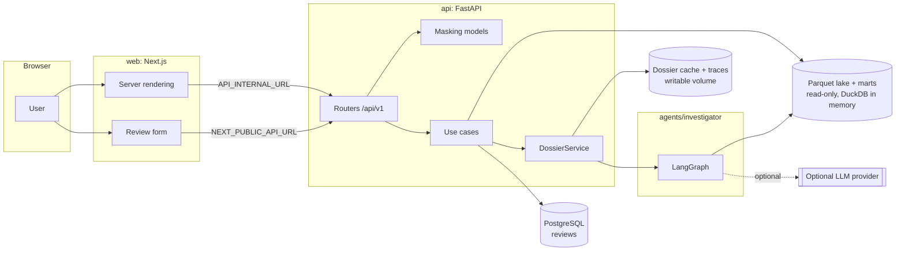
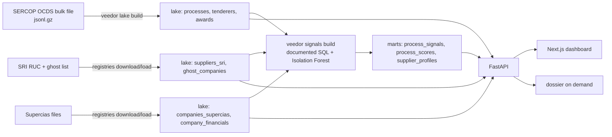
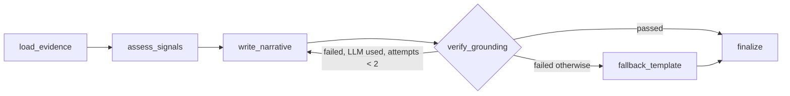

# Architecture

Veedor computes transparent risk indicators over Ecuador's open procurement data and serves them,
with evidence dossiers, through an API and a dashboard. The rules every component follows are in
`docs/CONTRACT.md`.

## Layers and the dependency rule

```
src/veedor/
  core/            settings, paths
  domain/          pure logic, no I/O, no framework imports
    signals/       indicator definitions, parameters, scoring weights
    dossier/       evidence-pack models, templates, grounding verifier, vocabulary
    masking.py     natural-person masking
  use_cases/       application services; query functions depend on ports (Protocols)
  infrastructure/  ocds (flattening), lake (DuckDB over Parquet, marts SQL), registries (SRI,
                   Supercias), db (SQLAlchemy + Alembic), llm (chat-model port), mcp
  agents/          investigator: LangGraph graph that writes and verifies a dossier
  api/ + schemas/  FastAPI routers and Pydantic response models
  cli/             Typer commands (`veedor ...`)
```

`domain` imports nothing from the other layers (no module under `domain/` imports `infrastructure`,
`use_cases` or `api`). `use_cases` depend on `domain` and on ports declared beside them
(`use_cases/queries/ports.py`); `infrastructure` implements the ports; `api` and `cli` call use cases.
Known deviation: `use_cases/build_dossier.py` wires concrete infrastructure (`EvidenceReader`, the LLM
factory) in `default_service()`, and `use_cases/queries/dossier.py` imports it lazily; the collaborators
are injectable, so tests use fakes.

## Component diagram



## Data-flow diagram



## Dossier graph (`agents/investigator`)

Defined in `agents/investigator/graph.py` (LangGraph); security notes in `agents/investigator/README.md`.



`load_evidence` and `assess_signals` are deterministic code. `write_narrative` calls the model only
when a provider is configured; otherwise (or on provider error) the deterministic template is used. The
verifier rejects any number, date, RUC, code or name not present in the evidence pack, and
`finalize` refuses unverified text. Each run appends a trace to `data/traces/`. The module was being
finished when this was written: treat the code as the reference ("see code").

## Key design decisions

| Decision | Reason |
|---|---|
| Parquet + DuckDB for analytics, PostgreSQL only for mutable state | The 2.25 M-process dataset is read-only between monthly rebuilds and scanned column-wise; Parquet files ship as a ~190 MiB bundle and need no server. Reviews are small, concurrent writes that need transactions, so they live in PostgreSQL. |
| Fresh in-memory DuckDB connection per query, locked down | `LakeReader` registers views over known files, restricts `allowed_directories`, disables external access and accepts only `SELECT`/`WITH` (`docs/SECURITY.md`); no shared mutable engine to corrupt. |
| Signals as documented SQL, thresholds from the data | Every indicator has a code, fields, threshold rule and caveats (`docs/METHODOLOGY.md`), so a reader can audit why a process scores as it does. The anomaly score is reported separately and never changes the risk score. |
| Deterministic facts first, LLM only for prose | Facts, signals and registry matches are computed by code into an `EvidencePack`; a model may only phrase them. With no provider the system is fully functional (template mode). |
| Grounding verifier as the control | Prompt instructions cannot stop a model from inventing or being steered by text planted in tender descriptions; checking the output against the pack can. Failure falls back to the template; unverified text is never stored or shown. |
| Masking at the API boundary | Internal tables keep real values (needed for joins and signals); response models mask natural persons so no endpoint can forget it. Dossier evidence is masked before the pack is built. |
| Wording as a product rule | "Señal de riesgo", "indicador", "atípico": the system reports indicators, never accusations. |
| Reviews separate from analytics | Human decisions never alter marts or scores, so the indicator pipeline stays reproducible from the raw file. |
